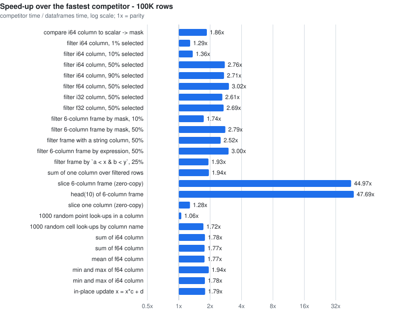
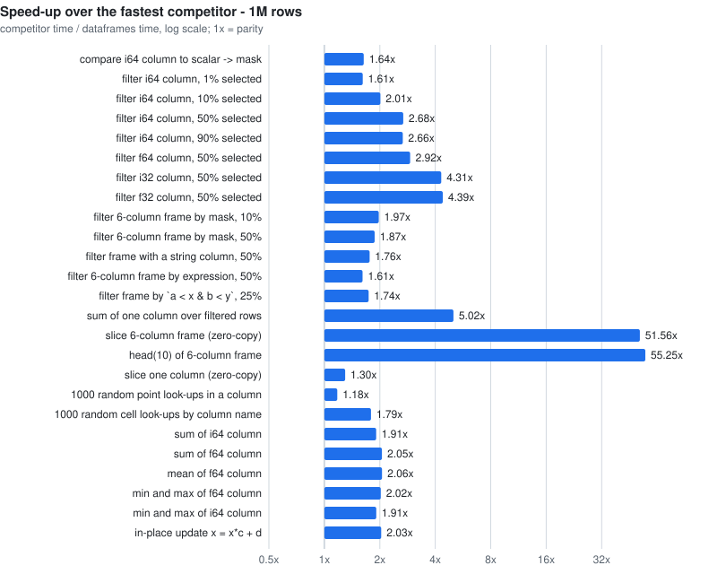
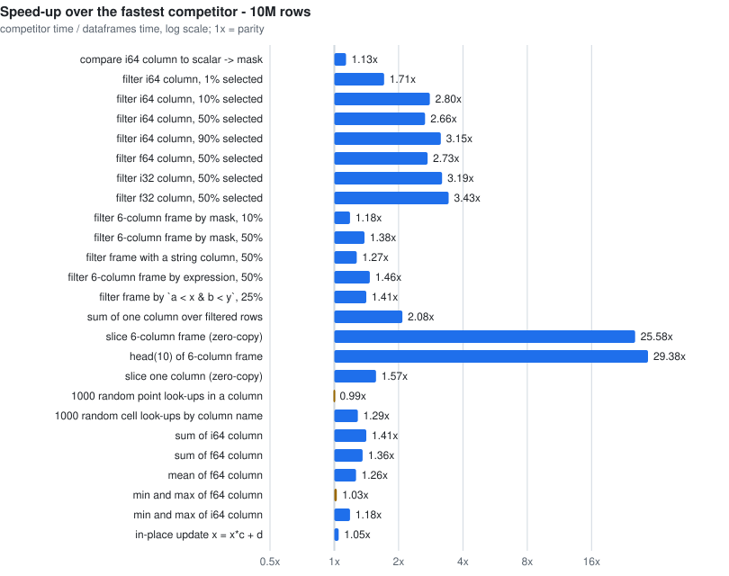

# dataframes

[](https://github.com/JamesClarke7283/dataframes-rs/actions/workflows/ci.yml)
[](https://github.com/JamesClarke7283/dataframes-rs/actions/workflows/bench.yml)
[](https://crates.io/crates/dataframes)
[](https://docs.rs/dataframes)

A zero-copy, columnar dataframe library for Rust with the API of Polars and pandas.

- **Repository:** `dataframes-rs` · **crate:** `dataframes` · **requires:** Rust 1.100 or newer (stable).
- **What it is:** an in-memory dataframe engine built from the allocator up — cache-line-aligned columns, SIMD filter kernels, O(1) slicing through smart pointers, and concurrent mutation with written-down guarantees.
- **The rule the design follows:** the implementation must balance extreme retrieval speeds with the complexity of safe concurrency and ownership management. Every mechanism below is a specific answer to that trade-off, and [docs/ARCHITECTURE.md](docs/ARCHITECTURE.md) records the reasoning.
- **How it is held to account:** a [GitHub Actions workflow](.github/workflows/bench.yml) benchmarks every push against Polars, Apache Arrow and pandas, publishes the numbers [below](#benchmarks), and fails if dataframes is slower than any of them anywhere.

```toml
[dependencies]
dataframes = "0.1"
```

```rust
use dataframes::prelude::*;

fn main() -> PolarsResult<()> {
    let df = df!(
        "city" => ["Oslo", "Lima", "Pune", "Oslo"],
        "temp" => [4.5, 19.0, 31.5, 6.0],
        "year" => [2023, 2023, 2024, 2024],
    )?;

    // Polars style: expressions and lazy queries.
    let warm = df
        .clone() // O(1): shares every buffer
        .lazy()
        .filter(col("temp").gt(lit(5.0)))
        .group_by([col("city")])
        .agg([col("temp").mean().alias("mean_temp"), len()])
        .collect()?;
    assert_eq!(warm.shape(), (3, 3));

    // pandas style: query strings, iloc, groupby.
    let recent = df.query("year == 2024 and temp > 5")?;
    assert_eq!(recent.iloc(-1)?.column("city")?.str()?.get(0), Some("Oslo"));
    assert_eq!(df.groupby(["year"])?.sum()?.column("temp")?.f64()?.get(0), Some(23.5));

    // Eager filtering runs on the SIMD kernels; slicing never copies.
    let mask = df.column("temp")?.f64()?.gt(5.0);
    let hot = df.filter(&mask)?;
    let last_two = hot.slice(1, 2);
    assert_eq!(last_two.column("year")?.i32()?.get(1), Some(2024));
    Ok(())
}
```

## Contents

- [Modular architecture](#modular-architecture)
- [Columnar memory layout](#columnar-memory-layout)
- [SIMD-accelerated filtering](#simd-accelerated-filtering)
- [Smart pointers for zero-overhead slicing](#smart-pointers-for-zero-overhead-slicing)
- [Thread-safe concurrent mutation](#thread-safe-concurrent-mutation)
- [Balancing retrieval speed against safe concurrency and ownership](#balancing-retrieval-speed-against-safe-concurrency-and-ownership)
- [The API: Polars and pandas](#the-api-polars-and-pandas)
- [Benchmarks](#benchmarks)
- [Status and limits](#status-and-limits)

## Modular architecture

Eight layers, each a module that builds on the ones beneath it. A layer can be read, tested and replaced on its own.

| layer | module | owns |
|------:|--------|------|
| 7 | [`sync`](src/sync/mod.rs) | concurrent mutation: snapshot-isolated `SharedFrame`, partitioned parallel updates |
| 6 | [`lazy`](src/lazy) | expressions, lazy plans, fused block-wise execution, pandas query strings |
| 5 | [`frame`](src/frame) | `DataFrame`: O(1) slice and clone, filter, sort, group-by, join |
| 4 | [`series`](src/series) | `Series`: a named column of any type, dispatched without a vtable |
| 3 | [`chunked_array`](src/chunked_array) | typed columns: numeric, boolean (bit-packed), string (16-byte views) |
| 2 | [`datatypes`](src/datatypes) | logical types, schema, dynamically typed cells |
| 1 | [`kernels`](src/kernels) | SIMD compare, compact and reduce kernels; the parallel ordered-commit pipeline |
| 0 | [`memory`](src/memory) | `ColumnAlloc`, `Buffer<T>`, `Bitmap` |

- **Layer 0 knows about bytes, not columns.** The allocator and the buffer smart pointer carry the layout guarantees; nothing above them repeats an alignment or lifetime argument.
- **Layer 1 knows about slices and mask words, not names or nulls.** Kernels take `&[T]` and `&[u64]`, which keeps them small enough to check against portable reference implementations for every type, operator and mask density.
- **Layers 2–5 are the data model.** They translate columns, nulls and frames into the slices the kernels want, and hold no `unsafe` beyond handing a kernel its output slot.
- **Layers 6–7 are policy.** Query planning and concurrency sit on top and can be ignored by code that only needs columns.
- **`unsafe` is fenced in.** It lives in `memory` and `kernels` plus a few documented call sites, and every block states the invariant it relies on.

## Columnar memory layout

The layout is a property of the allocator, not of each container. Rust 1.100 stabilised `std::alloc::Allocator` and the allocator-aware `Vec` constructors; this crate is built on them.

- **`ColumnAlloc` implements `std::alloc::Allocator`** and gives every column block four guarantees:
  - **64-byte alignment** — a column starts on a cache line and never shares its first line with a neighbour; vector loads do not straddle lines.
  - **A 64-byte writable apron after the block** — compaction kernels store whole vectors at the tail without a scalar epilogue or a bounds branch.
  - **Huge pages for big columns** — blocks of 2 MiB and more are mapped on a 2 MiB boundary and flagged `MADV_HUGEPAGE`: an 80 MB column needs 40 TLB entries instead of 20 480.
  - **Recycling** — large blocks return to a size-classed pool (capped at a quarter of RAM, decaying after 10 s idle), so the next result of that size costs a pointer pop instead of a page fault per 4 KiB.
- **A column under construction is a plain `Vec<T, ColumnAlloc>`.** No hand-rolled raw vector: `push`, `extend`, `resize` and `with_capacity_in` all work, and all inherit the layout.
- **Freezing is a pointer hand-over.** `Vec::into_parts_with_allocator` turns the vector into an immutable shared `Buffer<T>`; `Vec::from_parts_in` turns a uniquely owned buffer back. Neither touches an element.
- **Numeric columns** are one contiguous buffer of native values plus an optional validity bitmap. There is never a chunk list to search, so element access is a bounds check and a load.
- **Bitmaps** pack one bit per row into 64-bit words, least significant bit first, and know their population count. One word selects 64 rows, tests "all" or "none" with one compare and counts with one `popcnt`.
- **Booleans** are bitmaps; logic on them is word-wise and null-aware (Kleene).
- **Strings** are 16-byte views: up to 12 bytes inline, otherwise length, 4-byte prefix and a position in a shared data buffer. Filtering and slicing strings moves fixed-width views and copies no string bytes.
- **`Series`** is an inline enum over the typed columns — a `match`, not a heap box and a vtable.
- **`DataFrame`** is a shared column set plus a row window, which is why slicing a frame costs the same for six columns as for six hundred.
- **No interior mutability inside a column** — no cell, atomic or lock inline. The optimiser may therefore treat `&column` as read-only and keep pointer and length in registers across calls it cannot see into, which makes a plain `get` loop faster than the same loop over an Arrow array.

```rust
use dataframes::memory::{AlignedVec, Buffer, ColumnAlloc};

fn main() {
    // An ordinary Vec, with the column layout supplied by the allocator.
    let mut v: AlignedVec<f64> = Vec::with_capacity_in(1 << 20, ColumnAlloc);
    v.extend((0..1 << 20).map(|i| i as f64));
    assert_eq!(v.as_ptr() as usize % 64, 0);

    let whole = Buffer::from_aligned(v); // freeze: no copy
    let part = whole.slice(1000, 4096); // O(1): one count, one pointer
    assert!(std::ptr::eq(&whole[1000], &part[0])); // the same memory
}
```

## SIMD-accelerated filtering

A filter is two kernels joined by a bitmask: *compare* turns 64 rows into one mask word, *compact* turns a word and 64 rows into the surviving rows.

- **Compare → bitmask** for all ten numeric types with AVX2: three base predicates per type plus a complement cover the six operators; unsigned types use a sign-bit bias; floats follow a total order (NaN equals NaN and sorts last).
- **Table-driven compaction** without data-dependent branches: `vpermd` for 4- and 8-byte elements, `pshufb` for 1- and 2-byte elements, and 16-byte string views through the 8-byte kernel with doubled mask bits. The output offsets of all steps of a mask word come from its population counts up front, so no step waits for the previous one.
- **Sparse stretches use scalar steps** — the density of each group of mask words picks a fixed number of "lowest set bit, copy, clear" steps per word, again without a data-dependent branch.
- **Fusion** — when predicate and payload are the same column, the two kernels alternate over cache-sized blocks, so each block is compacted while it is still in L1/L2 and the column crosses the memory bus once.
- **Parallel and still contiguous** — the ordered-commit pipeline lets every core scan a block, take its output offset in a two-atomic-operation critical section, and compact into one shared allocation. The result is exactly what a sequential filter produces.
- **Non-temporal stores for results larger than the cache** — skipping the read-for-ownership of every output line removes a third of the memory traffic of a 50 % filter.
- **Frames share row-index lists** — a frame is filtered block by block over all its columns; a block keeping at most two rows in five turns its mask into a list of row indices once, and every column is gathered through it.
- **Small columns go parallel too** — the kernels run on a fork-join team whose workers keep polling for 100 µs after a parallel region, so the next region starts in about half a microsecond and columns from 64 KiB upwards use every core.
- **Predicates on frames are compiled** — `a < 5 & b > 2.0` becomes a tree of block kernels and is fused with the compaction of every output column; `filter(...).select([sum])` reduces the selected rows without materialising them.
- **Run-time dispatch** — the crate compiles for the baseline of its target and selects the AVX2 kernels at run time, once. `DATAFRAMES_SIMD=scalar` forces the portable kernels, which are also the reference the vector kernels are tested against.

## Smart pointers for zero-overhead slicing

- **`Buffer<T>` is three words:** a pointer to the first element *of this view*, a length, and a reference-counted owner.
- **Slicing is O(1) and leaves no residue.** `slice` bumps one count and offsets the pointer. The result has the same shape as an unsliced buffer: there is no stored offset to add on each access, so a slice of a slice of a slice reads as fast as the original.
- **Reading is a `&[T]`.** `Deref` hands the kernels a native slice; nothing between the caller and the bytes is dynamic.
- **Bitmaps and string views slice the same way,** sharing their words and data buffers; a bit offset below 64 covers slices that do not start on a word boundary.
- **A `DataFrame` slices in O(1) whatever its width.** `slice`, `head`, `tail` and `clone` copy a reference to the shared column set and a row window; columns are narrowed lazily, once, on first access.
- **Ownership decides mutability.** `Buffer::get_mut` succeeds only for the sole owner; `make_mut` falls back to copy-on-write. A shared buffer is therefore immutable by construction and `Send + Sync` without any synchronisation.
- **Foreign memory is welcome.** A buffer can adopt a `Vec`, an `Arc<[T]>` or any `Send + Sync` owner without copying.

## Thread-safe concurrent mutation

Four tiers, from cheapest to most general. Each rests on a different proof of safety, and none puts a lock on the read path. The full specification is in [`src/sync/mod.rs`](src/sync/mod.rs) and [docs/ARCHITECTURE.md](docs/ARCHITECTURE.md#5-concurrency-specification).

| tier | mechanism | what proves it safe | cost on the read path |
|-----:|-----------|---------------------|-----------------------|
| 0 | frozen sharing: frames, series and buffers are `Send + Sync` and immutable while shared | the type system | none |
| 1 | exclusive mutation: `&mut` methods update in place when the buffer is uniquely owned, else copy-on-write, per column | the borrow checker and one reference count | none |
| 2 | partitioned mutation: disjoint `&mut` parts of a column, or the columns of a frame, across threads | the borrow checker | none |
| 3 | snapshot isolation: `SharedFrame` publishes immutable versions; writers build the next one privately | one atomic version swap | one atomic load |

- **Readers never block and never see a partial write.** A `Snapshot` pins one version; everything reachable from it is frozen.
- **Writers are serialised and atomic.** A write runs on a private frame that shares every buffer with the current version and becomes visible in one step. A panic or an error publishes nothing.
- **A write costs what it touches.** Updating a column copies that column and shares the rest. Appending rows extends the shared buffers in place, beyond the end of every published view, and copies only the new rows.
- **Versions are totally ordered** by an epoch; a reader's epochs never go backwards.
- **Reclamation is by reference count.** A version's memory returns to the column pool when its last snapshot is dropped — no epochs to advance, no hazard pointers.
- **Deliberately not offered:** concurrent in-place updates of one column under readers. That would put an atomic or a lock on every element read; batch such updates into one write, or partition the column under a single writer.

```rust
use dataframes::prelude::*;

fn main() -> PolarsResult<()> {
    let shared = SharedFrame::new(df!("id" => [1i64, 2], "v" => [10.0, 20.0])?);
    let before = shared.snapshot(); // pins version 0

    std::thread::scope(|s| {
        // A writer appends a batch and rewrites a column as one atomic step.
        s.spawn(|| {
            shared.try_write(|df| {
                df.vstack_mut(&df!("id" => [3i64], "v" => [30.0])?)?;
                df.apply("v", |c| c * 2)?;
                Ok(())
            })
        });
        // Readers see the old version or the new one, never a mixture.
        s.spawn(|| {
            let snap = shared.snapshot();
            assert!(snap.height() == 2 || snap.height() == 3);
        });
    });

    assert_eq!(before.height(), 2); // an old snapshot is untouched
    assert_eq!(shared.snapshot().height(), 3);
    Ok(())
}
```

## Balancing retrieval speed against safe concurrency and ownership

The implementation must balance extreme retrieval speeds with the complexity of safe concurrency and ownership management. These are the places where the two pull against each other, and what was chosen.

- **Reads pay nothing for writers.** Shared data is immutable, so a read is a plain load — no lock, no atomic, no version check per element. The price is that writers copy what they change (tier 1) or publish whole versions (tier 3).
- **Ownership is checked once per operation, not once per element.** A mutation asks "am I the only owner?" with one reference-count read, then runs a tight loop over `&mut [T]`.
- **Offsets are applied when slicing, not when reading.** A view stores a pointer that is already offset, so reading through a slice costs exactly what reading the original costs. The price is one more word per handle than a bare `Arc`.
- **One chunk per column.** Appending may reallocate (amortised, and in place when the buffer is uniquely owned or has spare capacity past every view), but element access never searches a chunk list.
- **Layout guarantees live in one `unsafe impl`.** Kernels may assume alignment and the apron because `ColumnAlloc` promises them, instead of each call site re-proving it.
- **Parallelism has to earn its keep.** Workers that poll briefly instead of sleeping make the hand-off cheap enough for cache-sized columns; the price is a burst of idle CPU after each parallel region (`DATAFRAMES_SPIN_US=0` turns it off). Sleeping workers are woken only for inputs that repay the system call.
- **Determinism is kept where it is cheap.** Parallel filters produce the sequential result byte for byte; floating-point sums use a fixed association order and are bit-identical across thread counts and vector widths.
- **No hidden global state on the hot path.** CPU features, cache sizes and the thread pool are resolved once; afterwards a kernel call is a predictable branch away from its loop.

## The API: Polars and pandas

Names, argument order and semantics follow Polars' Rust API (0.55) — `use dataframes::prelude::*;` in place of `use polars::prelude::*;` — with pandas spellings alongside.

| | Polars style | pandas style |
|---|---|---|
| build | `df!`, `DataFrame::new`, `Series::new`, `Int64Chunked::from_slice` | `concat`, `assign`, `copy` |
| inspect | `shape`, `height`, `schema`, `dtypes`, `get_column_names`, `head`, `tail` | `size`, `keys`, `info`, `describe`, `memory_usage` |
| select | `column`, `select`, `drop`, `slice`, `get_row` | `iloc`, `loc`, `at`, `iat` |
| filter | `filter(&mask)`, `lazy().filter(col("a").gt(lit(1)))` | `query("a > 1 and b < 2.5")`, `isin`, `between` |
| transform | `with_column`, `with_columns`, `apply`, `cast`, `rename`, arithmetic operators | `eval`, `astype`, `clip`, `round`, `shift`, `diff`, `cumsum` |
| missing data | `null_count`, `is_null`, `drop_nulls`, `fill_null` | `isna`, `notna`, `dropna`, `fillna` |
| order | `sort`, `arg_sort`, `reverse`, `unique`, `take` | `sort_values`, `nlargest`, `nsmallest`, `drop_duplicates`, `duplicated` |
| aggregate | `sum`, `mean`, `min`, `max`, `median`, `std`, `var`, `quantile`, `n_unique` | `nunique`, `idxmin`, `idxmax`, `value_counts`, `count` |
| group | `group_by([..]).agg([..])`, `lazy().group_by(..).agg(..)` | `groupby([..]).sum()`, `.mean()`, `.count()` |
| combine | `join`, `inner_join`, `left_join`, `vstack`, `hstack` | `merge` |
| expressions | `col`, `lit`, `when().then().otherwise()`, `.alias`, `.sum`, `.is_between` | — |
| concurrency | `into_shared`, `SharedFrame`, `Snapshot`, `par_apply_columns` | — |

- **Data types:** `Boolean`, `Int8`–`Int64`, `UInt8`–`UInt64`, `Float32`, `Float64`, `String`, with nulls everywhere.
- **Errors** are `PolarsError` / `PolarsResult`, with the variant names Polars uses (`ColumnNotFound`, `ShapeMismatch`, `SchemaMismatch`, `ComputeError`, ...).

## Benchmarks

The block below is generated by `scripts/bench.py report`. [The benchmark workflow](.github/workflows/bench.yml) regenerates it on every push to `main` and commits it back; the machine it ran on is named in the block.

<!-- bench:start -->
**dataframes is the fastest library in 75 of 75 comparisons** and slower in none. Geometric-mean speed-up over the fastest competitor: **2.45x** (smallest 1.09x, largest 57.59x).

Machine: AMD EPYC 7763 64-Core Processor · 4 threads · Linux 7.0.0-1020-azure · 2026-11-21 04:21 UTC  
Versions: Polars (Rust crate) 0.55.2 · Arrow (arrow-rs) 60.1.0 · Polars (Python wheel) 2.1.0 · pandas 3.1.1







Every number behind the charts, per library: [bench/results/latest.md](bench/results/latest.md).
<!-- bench:end -->

**How the comparison is kept fair**

- **Every library gets its own process** and its best configuration: all Rust code is built with `-C target-cpu=native`, thin LTO and the same allocator; the Polars and pandas numbers come from their official wheels.
- **The strongest spelling wins.** Where a library offers several ways to do one thing (eager, lazy or streaming engine in Polars; `query` or mask in pandas; a fused single-pass call here), all are timed and the best one is reported.
- **Same data, same answer.** All drivers read bit-identical columns generated from a fixed seed and report a check value per case; the report refuses to rank results that disagree.
- **Interleaved runs.** Libraries take turns case by case, for several rounds, so frequency scaling, thermal limits and noisy neighbours hit all of them alike. The reported time is the best median over the rounds.
- **Level means level.** A difference below 3 % is reported as level, not as a win. Some operations are the same machine code in every library — a point look-up is a bounds check and a load — and can only ever be level.

**Run it yourself**

```sh
RUSTFLAGS="-C target-cpu=native" CARGO_TARGET_DIR=target/native \
  cargo build --release -p bench-ours -p bench-polars -p bench-arrow -p bench-common
pip install -r bench/python/requirements.txt          # optional: pandas and the Polars wheel
python3 scripts/bench.py run --per-case --libs ours,polars,arrow,python
python3 scripts/bench.py report
```

## Status and limits

- **Version 0.1.** The memory, kernel and concurrency layers are the point of the crate and are tested accordingly; the API surface covers the core of Polars and pandas, not all of either.
- **In memory only.** No CSV, Parquet or IPC readers yet.
- **Types:** no temporal, decimal, categorical or nested types yet.
- **Vector kernels:** AVX2 on x86-64, selected at run time; other targets run the portable kernels.
- **Huge pages and block recycling** use `mmap`/`madvise` on Unix; elsewhere large blocks come from the global allocator.

## License

Licensed under either of [Apache License, Version 2.0](LICENSE-APACHE) or [MIT license](LICENSE-MIT) at your option.
